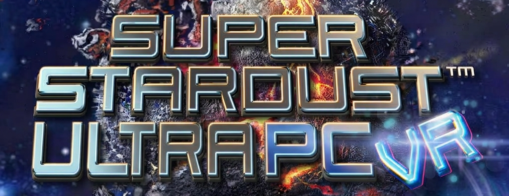

<a href="https://recomplauncher.com"><picture><source media="(prefers-color-scheme: dark)" srcset="https://recomplauncher.com/assets/press/launcher/badge-light.svg"></picture></a>

# Super Stardust Ultra VR (PS4) - Recompiled to PC

An (obviously) unofficial native PC runner for the PS4 version of <b>Super Stardust Ultra VR</b>, Housemarque's top-down twin-stick shooter.

The game's own x86-64 code runs directly on Windows and Linux: the PS4 system libraries it calls are reimplemented, and its GPU commands are drawn with Vulkan.

🚨 **No game files are included** 🚨

This requires a decrypted dump of your own copy of the game. Tested with **CUSA05951** (1.00), the european version without updates. Using other versions may cause bugs and crashes.

## Features

- **30, 60, 90, 120, 144 or 180 FPS** at normal game speed: the engine's own frame clock follows the setting.
  - Note: the engine runs fixed steps, so if your PC can't reach the chosen rate the game runs slower. Choose a rate your PC holds; 30 is there for lower-powered PCs.
- **Native 720p, 1080p, 1440p or 4K rendering**: the game itself draws at that size, HUD and menus included (the PS4 draws 1080p).
- **Windowed** (720p, 900p, 1080p, 1440p, 4K and more), **borderless** or **fullscreen**.
- **Built-in intro skip:** (optionally) goes straight to the main menu in about 10 seconds: the PS VR headset wait is gone, the logos run fast, and the usage terms and "Press X" screen are passed for you.
- **Display settings in the game:** press **F10**, or hold **Select** (View, Back, Share) or **Start**
  (Options, Menu) for a second, for window mode, resolution, VSync, frame rate, render resolution, sharpening and more.
- **Cheats:** press **L3+R3** (both sticks; on the keyboard X+M) during play for invulnerability,
  infinite lives, infinite bombs, maxed weapons and instant boost recharge. Triangle (Y) unchecks
  them all; your picks are remembered for the next start.
- **settings.exe** beside the game changes the same options (and speakers, intro skip) without starting it.
- **Keyboard and any gamepad.** DualShock 4 and DualSense work as they are, Xbox-style pads by
  button position. No mouse aiming _yet_.
- **Controller speaker:** a DualShock 4 or DualSense plugged in by USB plays the game's controller
  sounds on its own speaker, as on the PS4 (over Bluetooth they play on your speakers).
- **Local co-op with two gamepads:** a second controller plays as player 2 in the Multiplayer
  modes (co-op and versus).
- **Easy setup:** point the installer at your dumps, and it can add a desktop shortcut (on Linux, an application menu entry).
- **Self-contained:** shader caches, settings and paths stay in the game's folder; nothing goes to `%APPDATA%`.
- 🔵 Despite the name, this recomp does not support PCVR yet 🔵

## Why not just use shadPS4?

shadPS4 runs Super Stardust Ultra VR too, and this runner draws with its video core. On top of that, this runner gives you:

- **High frame rates at normal game speed** (up to 180 FPS): the game's own clock follows the setting, where raising the frame rate in an emulator speeds the game up.
- **Native 1440p and 4K rendering**: the game draws at that size itself, instead of upscaling a 1080p picture.
- **An intro skip** straight to the main menu in about 10 seconds.
- **Cheats** (L3+R3): invulnerability, infinite lives and bombs, maxed weapons, instant boost recharge.
- **FSR 1 sharpening**, switchable while you play.
- **DualShock 4 / DualSense speaker sounds** on the controller itself, over USB.
- **Display settings inside the game** (F10 or hold Select or Start) and in **settings.exe**.
- **A self-contained install**: no emulator setup, and nothing written outside the game's folder.

## Requirements

- **Windows:** Windows 10 or 11, 64-bit. Python and everything else comes with the release.
- **Linux:** x86-64 with glibc 2.39 or newer (SteamOS 3.7, Ubuntu 24.04, Debian 13, Fedora 40 or
  newer, Arch) and Python 3.10 or newer (`python3`) for the setup.
- A CPU with AVX.
- A GPU with Vulkan 1.3 and a current driver (on Linux, Mesa or the NVIDIA driver).
- A decrypted dump of your own copy of the game: the folder with `eboot.bin`, `sce_module`,
  `sce_sys`, `SD3_bank00.fev`, `stream.dat` and the game's other files.

## Install and play

1. [Download the latest release here](https://github.com/rcostanza/super-stardust-ultra-vr-recomp/releases/latest)
2. Unzip the release anywhere, for example `C:\Games\Super Stardust Ultra VR`.
3. Run `stardust-setup.exe`.
4. Choose your **game folder** (the dump) and a **save folder** (by default `save` inside the release folder). Each row says whether the folder is usable. Press **Install**: setup prepares the game from your dump in a few seconds and offers a desktop shortcut. Your dump is only read, never changed.
5. Press **Play Game**. Later, start `stardust.exe` or the shortcut.

Run `stardust-setup.exe` again any time to change folders; it offers to copy your saves when the save folder moves. Untick **Skip the intro movies** there (or set `skip_intro=0` in `settings.ini`, or use `settings.exe`) to see them again.

Setup also works from the command line:

```
stardust-setup.exe --game <dump> [--save <folder>]
```

### With RecompLauncher

[RecompLauncher](https://recomplauncher.com) can install and update it for you: pick your dump on the setup screen, and the game's
display settings show on its page there. The release's `recomplauncher.json` tells it how.

### On Linux

1. Extract the release anywhere you can write: `tar -xzf stardust-pc-<version>-linux-x64.tar.gz -C ~/Games`
2. Run `stardust-setup`: from a file manager it asks with dialogs, in a terminal it asks there. It also
   takes `--game <dump> [--save <folder>]`.
3. Start the game from the menu entry it adds, or run `./stardust`.

On a Steam Deck, do this in Desktop Mode; _Add a Non-Steam Game_ in Steam then lists the menu entry.

### Updating

Unzip the new release over the old folder and run the setup once more (the game asks you to). Your folders, saves, settings and shader caches are kept.

## Settings

`settings.ini` in your save folder holds every setting, each with a comment. The **Display Settings** panel (**F10**, or hold **Select** or **Start** for two seconds; the game pauses while it is open) changes most of them while the game runs and saves them when it closes; `settings.exe` beside the game changes all of them while it is closed:

- window mode, windowed resolution (applied a second after you stop changing it) and monitor. The game draws 16:9 only: the fullscreen modes pick a 16:9 size from the screen, with bars on other shapes;
- VSync, and tearing with VSync off (the least input delay);
- frame rate: 30, 60, 90, 120, 144 or 180 (30 for PCs that cannot hold 60), held to what your display refreshes at (180 on a 120 Hz display runs at 120) unless VSync is off with tearing allowed;
- render resolution (720p, 1080p, 1440p or 4K, at the next start);
- sharpening (AMD FSR 1 RCAS, on by default), applied at once; **F9** also switches it over the game, to compare.

## Controls

The game sees a DualShock 4 for each player. Any gamepad works, mapped by button position: on an
Xbox pad A B X Y are Cross, Circle, Square, Triangle, LB/RB are L1/R1, LT/RT are L2/R2, Menu is
Options and View clicks the touchpad.

**Two players:** the first gamepad found is player 1 and the second is player 2, as if a second
controller had signed in on the console. Each keeps its place while connected. Connect the second
pad before choosing Multiplayer. The keyboard always goes with player 1.

There's no mouse support (yet?), but the keyboard works alongside a gamepad:

| Keys                      | PS4                      |
| ------------------------- | ------------------------ |
| W A S D / I J K L         | left stick / right stick |
| arrow keys                | d-pad                    |
| Space, Enter              | Cross                    |
| Escape, Backspace, `;`    | Circle                   |
| F / H                     | Square / Triangle        |
| Q, Page Up / O, Page Down | L1 / R1                  |
| E / U                     | L2 / R2                  |
| X / M                     | L3 / R3                  |
| Tab, P                    | Options                  |
| T                         | touchpad click           |

| Shortcut                                     | What it does                                                |
| -------------------------------------------- | ----------------------------------------------------------- |
| **F10**, or hold **Select** or **Start** 1 s | Display Settings (pauses the game)                          |
| **F9**                                       | sharpening on or off                                        |
| **L3+R3** (or **X+M**)                       | Cheats (pauses the game)                                    |
| **F4**, or **Select+Start**                  | asks "Exit Super Stardust Ultra VR?" (No is selected first) |
| **Alt+F4**                                   | closes the game without confirmation                        |

## When something goes wrong

The game logs to `stardust.log` in the `log` folder of your save folder. If it closes by itself, it
says so and keeps that log as `crash-<date>-<time>.log` in the same folder; attach that file when
you report the problem. If the picture freezes, leave the game running for half a minute before
closing it: after 20 seconds without a new frame it writes what every thread is doing to the log.

## Building from source

[docs/building.md](docs/building.md) covers the toolchain, building, tests and packaging, and
[docs/development.md](docs/development.md) how the runner works and how to work on it.

## 🤖 AI usage disclaimer 🤖

**_This project was thoroughly made by AI._**

I (human) am a programmer, but I know nothing about C++ which is required to make this possible. And so, I've done precisely three things in this project:

1. Paid for AI
2. Told AI what to do
3. Tested out whatever AI did

## Credits and license

Based on [resogun-pc](https://github.com/rcostanza/resogun-recomp), itself inspired by [theatrhythm-fbl-pc](https://github.com/YAPhoa/theatrhythm-fbl-pc).

GPL-2.0-or-later, see [LICENSE](LICENSE). Runtime follows [shadPS4](https://github.com/shadps4-emu/shadPS4). Super Stardust Ultra VR is a game by Housemarque, published by Sony Interactive Entertainment; this project is not affiliated with or endorsed by either.
